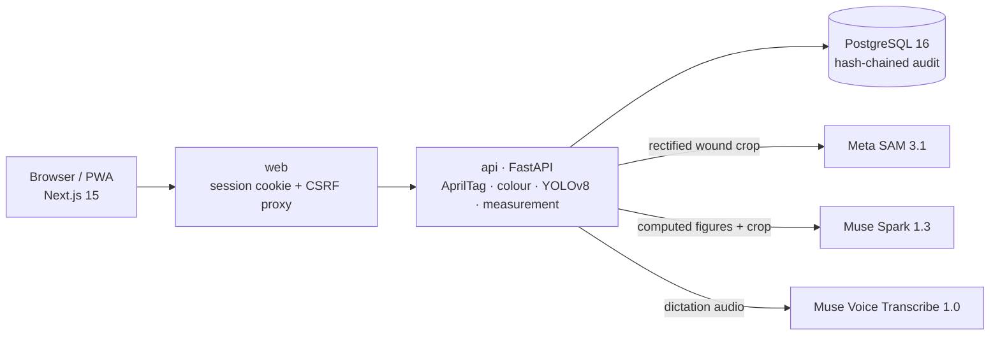

# WoundMeter

**AI assists. Families care. Professionals decide.**

WoundMeter turns a phone photo of a wound into a calibrated, clinician-verified measurement, so families caring at home and their professionals follow the same wound on the same scale over time.

*Meta Global AI Developer Hackathon (26 October–4 November 2026) · Theme: Build for Your World*

| Try it | Link |
| :--- | :--- |
| **Live application** (one-click demo accounts) | https://woundmeter.wtepsan.dev |
| **Interactive demo** (no sign-in, nothing saved) | https://woundmeter.wtepsan.dev/demo |
| **Photo guide** (with sample photos) | https://woundmeter.wtepsan.dev/instruction |

> **Research prototype.** WoundMeter is not a medical device. It does not diagnose, stage or treat wounds. Every AI result is a suggestion until a qualified clinician verifies and signs it.

---

## Why WoundMeter

More older adults now recover from pressure injuries, diabetic ulcers and surgical wounds at home. Their daily care falls to family members without clinical training, who do not know which changes matter or when to ask for help.

Nurses cannot visit every home every day. What reaches them is an uncalibrated phone photo, taken at a different distance and angle each time, so the same wound looks bigger or smaller and nobody can tell whether it is healing.

WoundMeter grew out of our elderly-care research to close that gap: **help families capture useful evidence, and keep professionals in charge of every decision.**

## What it does

```
Photo capture → calibrated measurement → Meta AI assistance → human correction → clinician approval → longitudinal tracking
```

1. **Capture.** A caregiver or nurse photographs the wound beside a printed L-ruler with four AprilTag markers and adds a short factual report (pain, drainage, dressing, redness).
2. **Calibrate.** The server corrects camera tilt and maps the wound onto a fixed 10 px/mm grid, so every photo is measured on the same scale.
3. **Assist.** Meta SAM 3.1 and a local YOLOv8 model outline the wound; Muse Spark 1.3 drafts observations and documentation.
4. **Correct.** A clinician checks the outline or redraws it, re-measured live. Every edit is a new version; AI proposals are never overwritten.
5. **Approve.** Only a qualified clinician can sign, after four explicit confirmations.
6. **Track.** Approved measurements build the progress chart. Families see only verified results.

A healed wound is a result, not an error: WoundMeter reports **No visible wound detected** and lets a clinician verify 0 cm² and mark the wound healed.

## What Meta AI enables

| Model | What it does in WoundMeter | Why it matters |
| :--- | :--- | :--- |
| **SAM 3.1** | Outlines the wound on the calibrated photo: a "wound" locator, then a box-and-point refinement guided by the local YOLO model, so skin-marker dashes, scars and new skin are not outlined | Irregular edges and slough defeat a small local model. SAM's boundary is close enough that clinicians correct rather than trace. |
| **Muse Spark 1.3** | Explains measurements, drafts observations, notes and longitudinal reports, rewrites wording ("Ask AI"), and answers questions about a record with read-only tools | Documentation is where clinicians lose time. Muse Spark sees only server-computed figures, and filters remove any diagnosis, staging or uncalibrated colour claim. Every draft is accepted, edited or rejected by the clinician. |
| **Muse Voice Transcribe 1.0** | Dictation in the clinical assistant; audio is never stored | Hands-free notes at the bedside. |

Numbers never come from a language model: area, length, width and perimeter are computed by deterministic OpenCV code. Meta models propose outlines and words; people decide.

## Try it in 3 minutes

No printed ruler is needed. These sample photos already include the WoundMeter ruler and show one wound healing over time:

| A · Open wound | B · Small wound (week 4) | C · Healed (week 8) |
| :---: | :---: | :---: |
|  |  |  |

1. **Measure (1 min).** In the [demo](https://woundmeter.wtepsan.dev/demo), press **Use this photo** on sample A, then **Measure this photo**: the straightened photo, AI outline and measurements appear.
2. **Correct (30 s).** Press **Edit boundary** and drag a point; the area re-measures live.
3. **Sign (30 s).** Read the Muse Spark draft under **AI assistance**, complete the form and four confirmations, and press **Approve & sign (demo)**. Nothing is saved.
4. **Healed (30 s).** Press **Measure another photo** with sample C: **No visible wound detected**, with **Record 0 cm²**, **Draw outline** or **Retake photo**.
5. **Connected care (30 s).** On the [application](https://woundmeter.wtepsan.dev), sign in as **Physician · Dr. Somchai (demo)** and open the fictional patient **Malee Sukjai (P-DEMO-HEAL)**: the verified area falls from 18.37 cm² to 0.86 cm², and the third photo shows no visible wound, ready to record as 0 cm². **Home caregiver · Suda (demo)** sees only approved results.

## Built during the hackathon

WoundMeter extends our earlier prototype, WoundWise.

| | What it is |
| :--- | :--- |
| **OLD** (before 26 Oct 2026) | Custom-trained YOLOv8 wound segmentation model (`best.pt`, Aug 2025); basic 12 cm three-tag L-ruler geometry (`ruler_template_v1.yaml`, Aug 2026) |
| **NEW** (26 Oct–4 Nov 2026) | Meta SAM 3.1 guided segmentation with its mask decoder; Muse Spark 1.3 drafts, observations, reports and record assistant with safety filters; Muse Voice dictation; dynamic 6–30 cm rulers and partial-frame coverage; 8-patch colour calibration (ΔE₀₀); interactive boundary editor with live re-measurement; four-confirmation clinician sign-off; no-visible-wound (0 cm²) and healed-wound workflow; multi-role platform for physicians, nurses, caregivers, patients and administrators; encrypted identifiers and hash-chained audit log; `/demo`, `/instruction` and deployment |

The repository was initialised on 4 November 2026, so the split rests on file dates, checksums and legacy `woundwise` identifiers: see [docs/TECHNICAL_DETAILS.md](docs/TECHNICAL_DETAILS.md#6-what-we-built-during-the-hackathon).

## Architecture



Three Docker Compose services; only the web server is exposed. Meta receives the rectified wound crop (no metadata), computed figures and dictation audio, never patient identity; identifiers are encrypted at rest. Code: [`nextjs-woundmeter/`](nextjs-woundmeter) (interface) and [`fastapi-woundmeter/`](fastapi-woundmeter) (pipeline, Meta client, care records).

## Evidence it works

- **Calibration (synthetic).** On a rendered ruler and an ellipse of known area, measured area was within +0.58% to +0.92% at 0°, 15° and 30° tilt.
- **Workflow.** An end-to-end API run passed 29/29 checks: measurement, sign-off rules, 0 cm², healing and reopening, caregiver permissions.
- **Live traces.** SAM 3.1 + YOLOv8 inference with disagreement warnings, rejection of photos without a ruler, and fallback to YOLOv8 when the Meta API timed out.
- **Builds.** All 53 backend modules compile; the frontend passes type checks and the production build.

Details and limits of each result: [docs/TECHNICAL_DETAILS.md](docs/TECHNICAL_DETAILS.md#12-validation-and-limitations).

## Run locally

Requires Docker with Compose v2, Python 3.10+, and the YOLOv8 weight file `best.pt` matching [`resources/models/SHA256SUMS`](resources/models/SHA256SUMS) (not in the repository).

```sh
python3 resources/configure.py                     # create .env with random secrets
python3 resources/install-model.py /path/to/best.pt  # install and checksum the model
```

Optionally edit `.env`:

```dotenv
META_AI_ENABLED=true          # live SAM 3.1, Muse Spark 1.3, Muse Voice
META_API_KEY=<your Meta Model API key>
WOUNDMETER_DEMO_MODE=true     # one-click demo accounts and /demo; never with real patient data
```

```sh
docker compose up -d --build
curl -fsS http://127.0.0.1:4456/ >/dev/null && echo "Web OK"
```

Open http://127.0.0.1:4456. Calibration, YOLOv8 and measurement work offline with `META_AI_ENABLED=false`. A fresh install has no patients. Rebuild after changing `WOUNDMETER_DEMO_MODE`.

## Responsible use

- A research prototype without regulatory clearance; not for unsupervised care.
- AI outlines and drafts are proposals. Diagnosis, staging, treatment and confirming healing belong to qualified professionals.
- Area is 2D: it misses depth, undermining and infection, and a smaller area alone does not prove healing.
- The ruler and colour references are not yet physically validated, blur thresholds are not set, and a wound the local model misses must be outlined by hand.

## Acknowledgements

- **Chiang Mai University**, International College of Digital Innovation (ICDI), for research support and the elderly-care research that inspired WoundMeter.
- **Clinical, nursing and caregiver collaborators**, whose experience of hospital-to-home care shaped the review workflow.
- **Meta** and the hackathon organisers, for the Meta Global AI Developer Hackathon and access to SAM 3.1, Muse Spark 1.3 and Muse Voice Transcribe 1.0.
- **Sample images:** adapted from Jia et al. (2026), Figure 3, with the WoundMeter ruler added ([doi.org/10.3389/fmed.2026.1776438](https://doi.org/10.3389/fmed.2026.1776438)), licensed under [CC BY 4.0](https://creativecommons.org/licenses/by/4.0/).
- **Open source:** Next.js, React, Tailwind CSS, Lucide, FastAPI, PostgreSQL, OpenCV (AprilTag 36h11), PyTorch and Ultralytics YOLOv8; the Braden Scale for pressure-injury risk.
