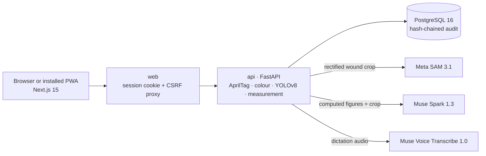

# WoundMeter

**AI assists. Families care. Professionals decide.**

WoundMeter turns a phone photo of a wound into a calibrated, clinician-verified measurement, using **Meta SAM 3.1** to outline the wound, **Muse Spark 1.3** to explain and document it, and **Muse Voice** for dictation, so families caring at home and their professionals follow the same wound on the same scale over time.

*Meta Global AI Developer Hackathon (26 October–4 November 2026) · Theme: Build for Your World*

| Try it | Link |
| :--- | :--- |
| **Live application** (one-click demo accounts) | https://woundmeter.wtepsan.dev |
| **Interactive demo** (no sign-in, nothing saved) | https://woundmeter.wtepsan.dev/demo |
| **Photo guide** (with sample photos) | https://woundmeter.wtepsan.dev/instruction |

**Use it like an app on a phone:** WoundMeter is a Progressive Web App. Where your browser supports it, tap **Install WoundMeter app** at the bottom of the page (on iPhone: Safari → **Share** → **Add to Home Screen**). It opens in its own window and uses the camera for capture; patient records and photos are never stored on the device. The demo and photo-guide pages have a header that leads back to the main page.

> **Research prototype.** WoundMeter is not a medical device. It does not diagnose, stage or treat wounds. Every AI result is a suggestion until a qualified clinician verifies and signs it.

---

## Why WoundMeter

**People confined to bed.** Anyone who cannot move for long, after a stroke, surgery, a spinal injury or a serious illness, can develop pressure injuries within days, and their wounds heal slowly. More and more of this care now happens at home rather than in hospital.

**Older adults most of all.** Most of these people are older, and ageing societies will have more of them every year: Japan is already a super-aged society, Thailand is one of the fastest-ageing countries in the world, and in England about one in five people is over 65.

**The care problems.**

- **Families carry the daily care** without clinical training: they don't know which changes matter or when to ask for help.
- **Professionals can't be everywhere.** There are too few nurses to see every patient at home every day.
- **Photos can't be compared.** What reaches the nurse is a phone photo taken at a different distance and angle each time, so the same wound looks bigger or smaller and nobody can tell whether it is healing.

WoundMeter grew out of our elderly-care research to close that gap: **help families capture useful evidence, and keep professionals in charge of every decision.**

## What it does

```
Photo capture → calibrated measurement → Meta AI assistance → human correction → clinician approval → longitudinal tracking
```

1. **Capture.** A caregiver or nurse photographs the wound beside a printed L-ruler with four AprilTag markers and adds a short factual report (pain, drainage, dressing, redness).
2. **Calibrate.** The server corrects camera tilt and maps the wound onto a fixed 10 px/mm grid, so every photo is measured on the same scale.
3. **Assist.** Meta SAM 3.1 and a local YOLOv8 model outline the wound; Muse Spark 1.3 drafts observations and documentation.
4. **Correct.** A clinician checks the outline or redraws it, re-measured live. Every edit is a new version; AI proposals are never overwritten.
5. **Approve.** Only a qualified clinician can sign, after four explicit confirmations.
6. **Track.** Approved measurements build the progress chart. Families see only verified results.

## How WoundMeter uses Meta AI

Three Meta models each do the part that fixed code or a small local model cannot, and each stays behind a human decision.

| Workflow step | Meta model | Who decides |
| :--- | :--- | :--- |
| Outline the wound | **SAM 3.1** | Clinician accepts, picks an alternative or redraws |
| Explain the measurement, draft observations and the note | **Muse Spark 1.3** | Clinician accepts, edits or rejects |
| Summaries, reports and questions about the record | **Muse Spark 1.3** (tool calling) | Clinician signs reports |
| Dictate at the bedside | **Muse Voice Transcribe 1.0** | User checks the transcript before sending |

### Meta SAM 3.1: the wound boundary

- **Two prompt modes in one time budget.** A text-concept pass (`"wound"`) finds candidate regions; a spatial pass then sends one box and interior point per wound, so SAM returns the whole wound bed, including slough that a "red wound" prompt leaves out.
- **Guided by our local model.** YOLOv8 decides *where* SAM looks; SAM decides *where the edge is*. This stops SAM outlining skin-marker dashes, scars or new skin, and when neither model finds a wound, WoundMeter reports **No visible wound detected** instead of measuring scar.
- **Privacy.** SAM receives only the rectified wound area, re-encoded without photo metadata, never patient identity.
- **Minimal choices.** One outline per wound, plus a "red tissue only" alternative only when it genuinely differs, with SAM–YOLO agreement (Dice/IoU) shown to the reviewer.
- **Built in the hackathon:** the client, a decoder for SAM 3.1's compressed mask format ([`sam_codec.py`](fastapi-woundmeter/app/services/sam_codec.py)), mask clean-up and the YOLO-guided seeding ([`sam_guidance.py`](fastapi-woundmeter/app/services/sam_guidance.py)).
- **Why it matters:** irregular edges and slough defeat a small local model; SAM's boundary is close enough that clinicians *correct* rather than *trace*.

### Meta Muse Spark 1.3: explainable documentation

Muse Spark returns structured JSON (fixed schemas) for five tasks:

1. **Measurement explanation and draft note**, written only from server-computed figures, with questions for the reviewer.
2. **Visual observations** from the rectified photo (multimodal). Colour-based findings are withheld when the colour calibration is not verified.
3. **"Ask AI"** rewording of a draft sentence.
4. **Wound summaries and longitudinal reports** across visits.
5. **Record assistant** using tool calling: eight tools read approved history, measurements, server-calculated visit comparisons, assessments, care plans and nursing summaries, and can start an *unsigned* report draft.

Deterministic checks back this up: visual observations lose any staging, diagnosis or tissue percentage, and "Ask AI" rewrites are flagged when they add numbers or clinical terms not in the original. The clinician's accept/edit/reject choice is recorded. **Why it matters:** documentation is where clinicians lose time; Muse Spark turns verified numbers into consistent notes and answers questions about a record in seconds.

### Muse Voice Transcribe 1.0: hands-free notes

Nurses dictate questions to the record assistant. Audio is sent once and never stored, and the transcript only fills the text box: it is sent after the user checks it.

### Numbers stay deterministic; Meta stays optional

Area, length, width and perimeter always come from our own OpenCV code on the calibrated grid, never from a language model. If the Meta API is unavailable, measurement falls back to YOLOv8 and explanations to a deterministic template, and the record says so.

## Try it in 3 minutes

No printed ruler is needed. These sample photos already include the WoundMeter ruler and show one wound healing over time:

| A · Open wound | B · Small wound (week 4) | C · Healed (week 8) |
| :---: | :---: | :---: |
|  |  |  |

1. **SAM 3.1 outline (1 min).** In the [demo](https://woundmeter.wtepsan.dev/demo), press **Use this photo** on sample A, then **Measure this photo**: the straightened photo, the SAM outline, SAM–YOLO agreement and the measurements appear.
2. **Correct (30 s).** Press **Edit boundary** and drag a point; the area re-measures live.
3. **Muse Spark draft (30 s).** Read the explanation and draft note under **AI assistance**, try **Generate AI observations**, then complete the four confirmations and **Approve & sign (demo)**. Nothing is saved.
4. **Healed (30 s).** Press **Measure another photo** with sample C. SAM and YOLO find no open wound, so WoundMeter shows **No visible wound detected**, with **Record 0 cm²**, **Draw outline** or **Retake photo**.
5. **Connected care (30 s).** On the [application](https://woundmeter.wtepsan.dev), sign in as **Physician · Dr. Somchai (demo)** and open the fictional patient **Malee Sukjai (P-DEMO-HEAL)**: the verified area falls from 18.37 cm² to 0.86 cm², and the third photo shows no visible wound, ready to record as 0 cm². On the **AI reports** tab, ask the **record assistant** (Muse Spark, with voice input) how the wound has changed. **Home caregiver · Suda (demo)** sees only approved results.

## Built during the hackathon

WoundMeter extends WoundWise, a prototype from earlier joint research (see [Acknowledgements](#acknowledgements)). The hackathon build was done by a single developer.

| | What it is |
| :--- | :--- |
| **OLD** (before 26 Oct 2026) | Custom-trained YOLOv8 wound segmentation model (`best.pt`, Aug 2025); basic 12 cm three-tag L-ruler geometry (`ruler_template_v1.yaml`, Aug 2026) |
| **NEW** (26 Oct–4 Nov 2026) | **All Meta integration:** SAM 3.1 YOLO-guided segmentation and mask decoder; Muse Spark 1.3 explanations, visual observations, Ask AI, reports and tool-calling record assistant with safety filters; Muse Voice dictation. **Plus:** dynamic 6–30 cm rulers and partial-frame coverage; 8-patch colour calibration (ΔE₀₀); interactive boundary editor with live re-measurement; four-confirmation clinician sign-off; no-visible-wound (0 cm²) and healed-wound workflow; multi-role platform for physicians, nurses, caregivers, patients and administrators; encrypted identifiers and hash-chained audit log; `/demo`, `/instruction` and deployment |

The repository was initialised on 4 November 2026, so the split rests on file dates, checksums and legacy `woundwise` identifiers: see [docs/TECHNICAL_DETAILS.md](docs/TECHNICAL_DETAILS.md#6-what-we-built-during-the-hackathon).

## Architecture



Three Docker Compose services; only the web server is exposed. Meta never receives patient identity; identifiers are encrypted at rest. Code: [`nextjs-woundmeter/`](nextjs-woundmeter) (interface) and [`fastapi-woundmeter/`](fastapi-woundmeter) (pipeline, Meta client, care records).

## Evidence it works

- **Calibration (synthetic).** On a rendered ruler and an ellipse of known area, measured area was within +0.58% to +0.92% at 0°, 15° and 30° tilt.
- **Workflow.** An end-to-end API run passed 29/29 checks: measurement, sign-off rules, 0 cm², healing and reopening, caregiver permissions.
- **Live Meta traces.** SAM 3.1 inference at 4.5–5.4 s per photo alongside YOLOv8 (~0.2 s), with disagreement warnings, and automatic fallback to YOLOv8 when the Meta API timed out.
- **Meta failure cases fixed.** On real photos, YOLO-guided SAM outlined the open wound instead of pen-mark dashes (0.49 → ~14 cm²), the open area of a healing wound instead of the whole pink zone (16.1 → 2.6 cm²), and reported a healed scar as no visible wound instead of 30 cm².

Details and limits of each result: [docs/TECHNICAL_DETAILS.md](docs/TECHNICAL_DETAILS.md#12-validation-and-limitations).

## Run locally

Requires Docker with Compose v2, Python 3.10+, and the YOLOv8 weight file `best.pt` matching [`resources/models/SHA256SUMS`](resources/models/SHA256SUMS) (not in the repository).

```sh
python3 resources/configure.py                     # create .env with random secrets
python3 resources/install-model.py /path/to/best.pt  # install and checksum the model
```

Optionally edit `.env`:

```dotenv
META_AI_ENABLED=true          # live SAM 3.1, Muse Spark 1.3, Muse Voice
META_API_KEY=<your Meta Model API key>
WOUNDMETER_DEMO_MODE=true     # one-click demo accounts and /demo; never with real patient data
```

```sh
docker compose up -d --build
curl -fsS http://127.0.0.1:4456/ >/dev/null && echo "Web OK"
```

Open http://127.0.0.1:4456. Calibration, YOLOv8 and measurement work offline with `META_AI_ENABLED=false`. A fresh install has no patients. Rebuild after changing `WOUNDMETER_DEMO_MODE`.

## Responsible use

- A research prototype without regulatory clearance. AI outlines and drafts are proposals; diagnosis, staging, treatment and confirming healing belong to qualified professionals.
- Area is 2D: it misses depth, undermining and infection, and a smaller area alone does not prove healing.
- The ruler and colour references are not yet physically validated, blur thresholds are not set, and a wound the local model misses must be outlined by hand.

## Acknowledgements

- **Meta**, for hosting the Meta Global AI Developer Hackathon and providing access to SAM 3.1, Muse Spark 1.3 and Muse Voice Transcribe 1.0, which power WoundMeter's wound outlines, documentation and dictation.
- **Previous work.** The idea behind WoundMeter (connecting family caregivers at home with professional review) comes from earlier joint elderly-care research at the International College of Digital Innovation (ICDI), **Chiang Mai University**, with clinical, nursing and caregiver collaborators. That work also produced the WoundWise prototype: the YOLOv8 wound model and the first ruler design listed as OLD above.
- **The hackathon build.** Everything listed as NEW was designed and built by Worawit Tepsan during the hackathon.
- **Sample images:** adapted from Jia et al. (2026), Figure 3, with the WoundMeter ruler added ([doi.org/10.3389/fmed.2026.1776438](https://doi.org/10.3389/fmed.2026.1776438)), licensed under [CC BY 4.0](https://creativecommons.org/licenses/by/4.0/).
- **Open source:** Next.js, React, Tailwind CSS, Lucide, FastAPI, PostgreSQL, OpenCV (AprilTag 36h11), PyTorch and Ultralytics YOLOv8; the Braden Scale for pressure-injury risk.
