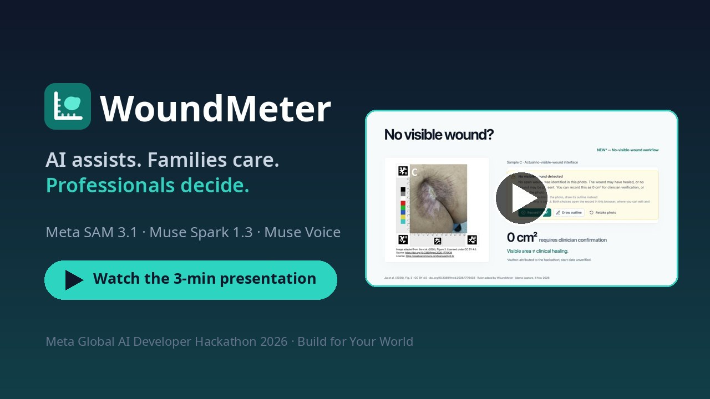
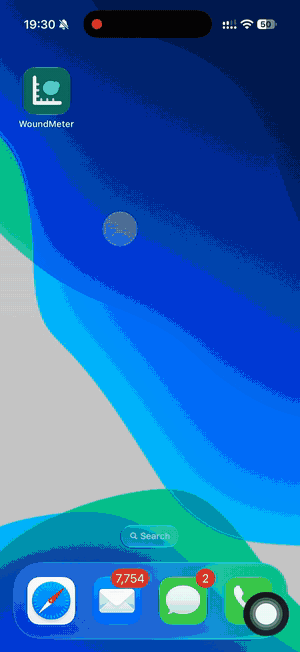
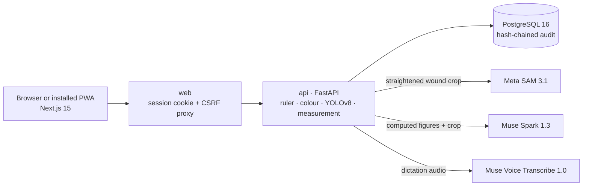

# WoundMeter

**AI assists. Families care. Professionals decide.**

WoundMeter turns a phone photo of a wound into a calibrated measurement that a clinician checks and signs. **Meta SAM 3.1** proposes the wound outline, **Muse Spark 1.3** helps write and understand the record, and **Muse Voice** turns dictation into text. Families at home and their care team then follow the same wound, on the same scale, over time.

*Meta Global AI Developer Hackathon, 26 October–4 November 2026 · Theme: **Build for Your World** · Solo entry by Worawit Tepsan*

## Presentation

<p align="center">
  <a href="https://www.youtube.com/watch?v=HSMxFIOesmw" title="Watch the 3-minute presentation on YouTube">
    
  </a>
  <br>
  <sub>▶ <a href="https://www.youtube.com/watch?v=HSMxFIOesmw">Watch the 3-minute presentation on YouTube</a></sub>
</p>

## Demo on a phone

<table>
  <tr>
    <td width="300" align="center">
      <a href="https://youtube.com/shorts/lW2WnGX9CHQ" title="Watch the phone demo on YouTube">
        
      </a>
      <br>
      <sub>Shown at 6× speed · ▶ <a href="https://youtube.com/shorts/lW2WnGX9CHQ">full phone demo (YouTube Short)</a></sub>
    </td>
    <td>
      <b>Installs like a phone app (PWA).</b> WoundMeter is a Progressive Web App, so there is no app store. In Chrome or Edge, tap <b>Install WoundMeter app</b> at the bottom of the page. On an iPhone, use Safari → <b>Share</b> → <b>Add to Home Screen</b>.
      <br><br>
      The installed app opens in its own window and takes the ruler photo with the phone camera. Patient records and photos are never stored on the phone.
      <br><br>
      <b>Try it yourself</b>
      <ul>
        <li><a href="https://woundmeter.wtepsan.dev">Live application</a> (one-click demo accounts)</li>
        <li><a href="https://woundmeter.wtepsan.dev/demo">Interactive demo</a> (no sign-in, nothing saved)</li>
        <li><a href="https://woundmeter.wtepsan.dev/instruction">Photo guide</a> (with sample photos)</li>
      </ul>
    </td>
  </tr>
</table>

> **Research prototype, not a medical device.** WoundMeter gives no health advice to patients or families and does not diagnose, stage or treat wounds. Every AI result stays a suggestion until a qualified clinician verifies and signs it.

## The problem

1. **Ageing societies, more care at home.** Japan, Thailand and England are ageing fast. Older adults confined to bed can develop pressure wounds within days, and more of them are cared for at home.
2. **Families have no reliable way to document wound changes.** They change dressings without clinical training.
3. **Professionals can't review every wound in person every day.**
4. **Ordinary photos can't be compared.** A different distance or angle each time makes the same wound look bigger or smaller.
5. **WoundMeter connects home monitoring with clinician-verified records.**

The idea comes from my earlier elderly-care research with clinical and nursing colleagues.

## The solution

```
Photo with ruler → calibrated measurement → Meta AI suggestions → clinician correction → clinician sign-off → history
```

1. **Capture.** A caregiver photographs the wound beside a printed AprilTag L-ruler and notes pain, drainage and dressing.
2. **Calibrate** *(pre-existing)*. The ruler straightens the photo onto a fixed 10 px/mm scale. A colour check *(new)* flags photos whose colours can't be trusted.
3. **Suggest.** SAM 3.1 proposes the outline, and Muse Spark drafts observations and a note.
4. **Correct.** A clinician accepts or drags the outline, and the area re-measures live. Each edit is a new version.
5. **Sign.** Only a qualified clinician can approve a record, after four explicit confirmations.
6. **Follow.** Signed measurements build the history that families see.

## Powered by Meta AI

| Meta model | What it does in WoundMeter | Who decides |
| :--- | :--- | :--- |
| **SAM 3.1** | Proposes the wound boundary on the straightened photo | Clinician accepts, picks an alternative or redraws |
| **Muse Spark 1.3** | Explains the measurement, drafts observations and the note, answers questions about the record (tool calling) | Clinician accepts, edits or rejects; reports stay unsigned drafts |
| **Muse Voice Transcribe 1.0** | Turns spoken questions into text | User checks the text before sending |

Key design points (new unless marked):

- **YOLO-guided SAM.** On its own, SAM's "wound" text search also outlined pen marks, scars and new skin. Now the local YOLOv8 model picks *where* to look, and SAM finds *the edge* from box and point prompts. If neither model finds an open wound, WoundMeter reports **No visible wound detected**. I also wrote a decoder for SAM 3.1's compressed mask format.
- **Muse Spark sees only verified facts.** It gets server-computed numbers and no patient identity. Its outputs follow fixed JSON schemas, and the record assistant reads approved data through eight tools.
- **Numbers never come from a language model.** The pre-existing OpenCV measurement code computes them on the calibrated grid. Without the Meta API, WoundMeter falls back to YOLOv8 and template text, and the record says so.

Algorithms, prompts and safeguards: [docs/TECHNICAL_DETAILS.md](docs/TECHNICAL_DETAILS.md#7-meta-ai-integration).

## Try the demo (3 minutes)

No printed ruler is needed: these sample photos already include it.

| A · Open wound | B · Week 4 | C · Healed, week 8 |
| :---: | :---: | :---: |
|  |  |  |

1. **Outline.** In the [demo](https://woundmeter.wtepsan.dev/demo), press **Use this photo** on sample A, then **Measure this photo**. The straightened photo, the SAM outline and the measurements appear.
2. **Correct.** Press **Edit boundary**, drag a point and watch the area update. Then press **Done editing**.
3. **Document.** Read the Muse Spark draft under **AI assistance**, tick the four confirmations and press **Approve & sign (demo)**. Nothing is saved.
4. **Healed.** Press **Measure another photo** and use sample C. WoundMeter shows **No visible wound detected**, with **Record 0 cm²**, **Draw outline** and **Retake photo**.
5. **Connected care.** On the [application](https://woundmeter.wtepsan.dev), sign in as **Dr. Somchai** (physician) and open the fictional patient **Malee Sukjai (P-DEMO-HEAL)**. Her chart shows three visits. On the **AI reports** tab, ask the record assistant how the wound has changed. The **Suda** (home caregiver) account sees only signed visits.

*The sample photos were adapted from a published case report, and the ruler was added digitally. Their cm² values show how the workflow runs; they are not true wound sizes.*

## Built during the hackathon

**PRE-EXISTING** (WoundWise prototype, before 26 Oct 2026):
- YOLOv8 wound model (`best.pt`, Aug 2025), *reused as-is*.
- AprilTag L-ruler, geometric correction and physical measurement (`ruler_template_v1.yaml`, Aug 2026, and the ruler image in the photo guide), *code adapted*.
- The idea of linking family caregivers with professional review, from earlier joint research.

**NEW** (26 Oct–4 Nov 2026):
- Meta SAM 3.1 integration, YOLO-guided prompts and mask decoder.
- Muse Spark 1.3 explanations, observations, reports and record assistant.
- Muse Voice transcription.
- Colour calibration.
- Boundary correction with versioning.
- Clinician sign-off, the audit log and the multi-role home-care platform.
- The no-visible-wound and 0 cm² workflow.
- `/demo`, `/instruction`, the PWA, documentation and deployment.

I built the hackathon version alone, with AI coding assistance. Some prototype code was adapted; most of the code is new. The repository was created on 4 Nov 2026, so this split rests on file dates, checksums and leftover `woundwise` identifiers ([details](docs/TECHNICAL_DETAILS.md#6-what-we-built-during-the-hackathon)).

## Architecture and setup



The app runs as three Docker Compose services, and only the web server is exposed. Meta never receives patient identity.

You need Docker Compose v2, Python 3.10+, and the YOLOv8 weight file `best.pt` that matches [`resources/models/SHA256SUMS`](resources/models/SHA256SUMS). The weight file is not in the repository.

```sh
python3 resources/configure.py                       # create .env with random secrets
python3 resources/install-model.py /path/to/best.pt  # install and checksum the model
# optional in .env: META_AI_ENABLED=true, META_API_KEY=..., WOUNDMETER_DEMO_MODE=true
docker compose up -d --build
curl -fsS http://127.0.0.1:4456/ >/dev/null && echo "Web OK"
```

Open http://127.0.0.1:4456. Without Meta access, calibration, YOLOv8 and measurement still work. Never use demo mode with real patient data.

## Evidence and limitations

- **Workflow:** an end-to-end API run passed 29/29 checks (sign-off rules, 0 cm², healing, caregiver permissions). The script is not in the repository.
- **Meta in use:** live SAM 3.1 calls took 4.5–5.4 s per photo. When the API timed out, WoundMeter fell back to YOLOv8.
- **Failures fixed on a few real photos:** SAM outlined pen marks, the whole pink zone and a healed scar (30 cm²). It now outlines the open wound, or reports no visible wound. This is not a validation study.
- **Ruler *(pre-existing)*:** area error under 1% on a synthetic test at up to 30° tilt.

**Limitations.**
- No regulatory clearance or clinical study.
- Area is 2D, and a smaller area alone does not show healing.
- The printed ruler and colour patches are not physically validated.
- A wound the local model misses must be drawn by hand.
- No automated test suite is committed.

More: [validation and limitations](docs/TECHNICAL_DETAILS.md#12-validation-and-limitations).

## Acknowledgements

- **Meta and Cerebral Valley**, for organising the hackathon and enabling model access.
- **Chiang Mai University**, particularly the **International College of Digital Innovation**, for the elderly-care research where the WoundWise prototype and this idea began.
- **ISPF Research Fellows**, for research exchange and collaboration.
- **Earlier clinical and nursing collaborators**, whose practical insight shaped the idea. They did not take part in the hackathon build.
- **Worawit Tepsan** built everything listed as NEW, alone, during the hackathon, with AI coding assistance.
- **Sample images** adapted from Jia Z. et al. (2026), *Frontiers in Medicine*, Figure 3 ([doi.org/10.3389/fmed.2026.1776438](https://doi.org/10.3389/fmed.2026.1776438)), [CC BY 4.0](https://creativecommons.org/licenses/by/4.0/). Changes: images cleaned up and the WoundMeter ruler added digitally.
- **Open source:** Next.js, React, Tailwind CSS, Lucide, FastAPI, PostgreSQL, OpenCV, PyTorch and Ultralytics YOLOv8; the Braden Scale.
