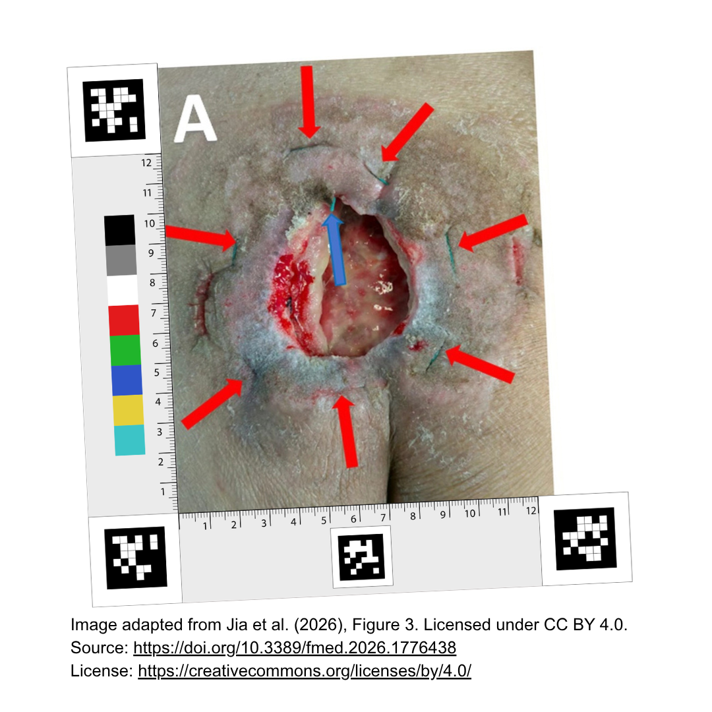
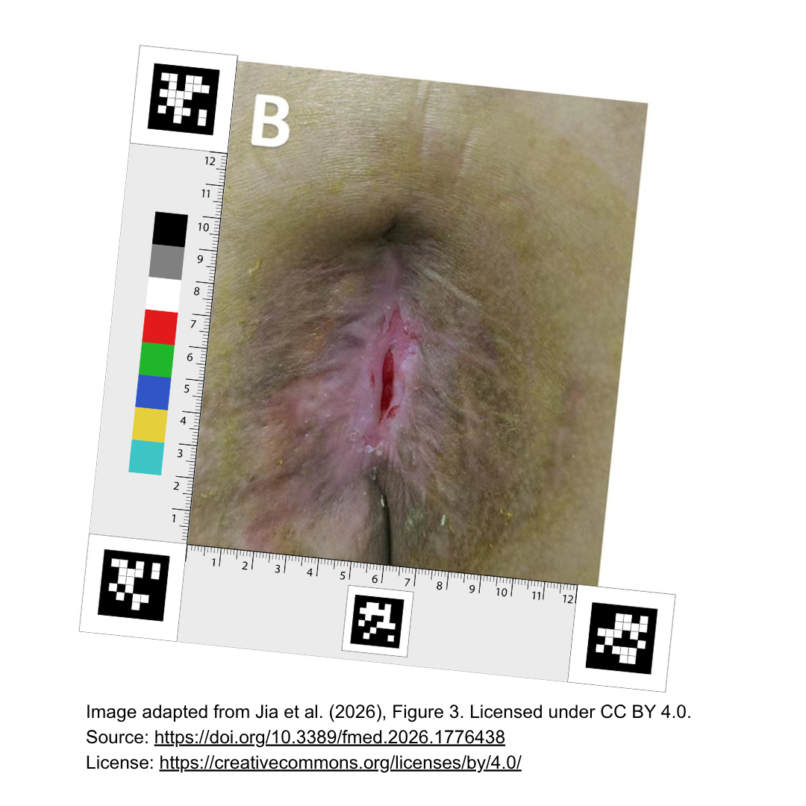
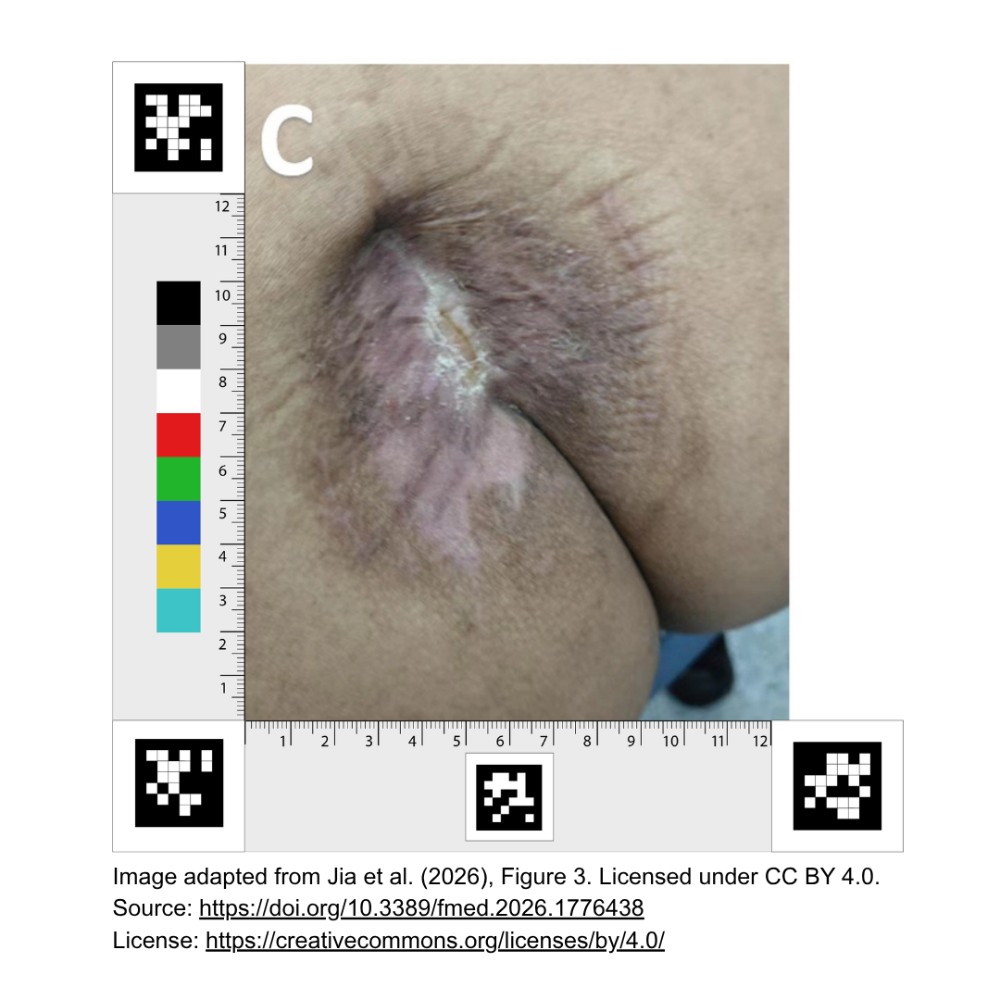
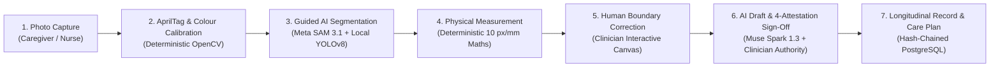
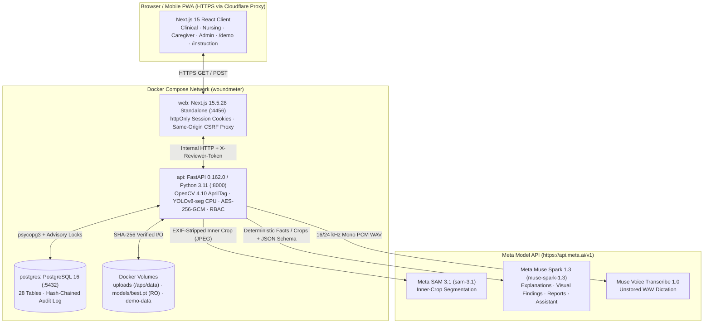

# WoundMeter

**AI-Assisted Wound Documentation, Calibrated Physical Measurement, and Human-Verified Connected Care**

> **Core Principle:** **AI assists. Families care. Professionals decide.**
>
> *WoundMeter is a human-in-the-loop research prototype developed for the Meta Global AI Developer Hackathon (26 October–4 November 2026). It is not a certified medical device and must not be used for autonomous clinical diagnosis, staging, or treatment decisions.*

---

## 1. The Idea — Why WoundMeter Exists

WoundMeter grew out of our previous work in elderly care.

As populations age, more older adults are cared for at home rather than in hospital wards. Day-to-day responsibility falls on family members—sons, daughters, grandchildren, cousins, and informal caregivers—who care deeply for their loved ones but rarely have formal clinical training. When an older adult develops a chronic wound or pressure injury, family caregivers face a stressful daily reality: they change dressings and clean the skin, yet they often do not know which visual changes matter, how to document a wound consistently under changing room light and camera angles, or when a change requires urgent professional attention.

At the same time, community nurses and wound-care clinicians cannot stand at every bedside every day. When families and clinicians do communicate, updates often consist of uncalibrated smartphone photos taken at arbitrary distances and angles, accompanied by subjective descriptions that make longitudinal comparison unreliable.

That gap led us to ask one central question:

> **"How can we help family caregivers know what to observe, what to do, and when to seek professional help, while keeping healthcare professionals involved?"**

WoundMeter was built to explore this question. Its purpose is not to replace nurses or physicians with automated judgements, nor to turn family members into clinicians. Instead, WoundMeter connects everyday home caregiving with qualified professional oversight through calibrated photography, explainable AI assistance, and an auditable clinical review workflow:

**AI assists. Families care. Professionals decide.**

---

## 2. The Problem

Caring for chronic wounds across hospital-to-home transitions exposes five interlocking challenges:

1. **More older adults receive complex care at home:** Pressure injuries, diabetic foot ulcers, and surgical or venous wounds increasingly require weeks or months of monitoring outside the hospital.
2. **Family caregivers have limited medical training:** Informal caregivers struggle to judge whether a wound is improving or worsening, what symptoms to record (pain, exudate, dressing state, periwound redness), and when to escalate concerns.
3. **Smartphone photographs are geometrically and colorimetrically inconsistent:** Without a physical reference on the wound plane, a closer camera or a tilted phone makes the same wound appear larger or smaller, while warm indoor bulbs distort tissue appearance.
4. **Healthcare professionals cannot continuously observe every patient at home:** Clinicians need structured, comparable evidence to prioritise review queues without being overwhelmed by unverified or unusable photographs.
5. **Communication gaps between families and clinicians:** Caregivers rarely receive clear, versioned feedback on whether their photo was usable or whether care instructions have changed, and clinicians lack an auditable trail separating raw AI suggestions from verified clinical records.

---

## 3. Our Solution — WoundMeter

WoundMeter is an end-to-end **AI-assisted wound documentation and professional review platform** that links family caregivers, ward and community nurses, and wound clinicians around a shared, permission-governed longitudinal record.

```
Patient → Wound → Capture → AI Analysis → Measurement → Human Correction → Clinical Review → Approval → History
```

1. **Patient & Wound Registration:** Qualified clinical staff register patients (with AES-256-GCM encrypted identifiers), document anatomical wound sites, and grant scoped access to assigned family caregivers via **Care team & sharing**.
2. **Guided Capture at Home or Bedside:** A caregiver or nurse places an L-shaped physical calibration ruler framed by four **AprilTag 36h11** fiducial markers beside the wound, captures an uncropped photograph, and records structured factual observations (pain score, drainage level, dressing condition, redness, and caregiver concerns).
3. **Homography Rectification & AI Segmentation:** The backend detects the AprilTag markers, verifies geometric reprojection error, warps the wound plane onto a canonical **10 px/mm (`0.1 mm` grid)** coordinate system, evaluates an 8-patch colour reference strip, and runs **Meta SAM 3.1** alongside a local **YOLOv8-seg** model on the privacy-cropped inner measurement window.
4. **Deterministic Physical Measurement:** OpenCV and NumPy—never a language model—calculate physical wound area ($\text{cm}^2$), perimeter ($\text{cm}$), ruler-axis chords, and clinical maximum Feret length and perpendicular width ($\text{cm}$).
5. **Interactive Human Boundary Correction:** Before any record can be signed, a qualified clinician inspects the rectified photograph, compares AI candidate outlines (whole-wound refined boundary vs. concept boundary vs. local YOLO), or edits the polygon vertices directly in the browser with live server-side re-measurement.
6. **Explainable AI Documentation Assistance:** **Meta Muse Spark 1.3** drafts structured visual observations, measurement explanations, and bedside verification questions, while **Muse Voice Transcribe 1.0** supports unstored voice dictation. Deterministic safety filters strip any diagnostic, staging, or uncalibrated colour claims.
7. **Four-Attestation Clinical Approval & Longitudinal History:** A qualified clinician with `SIGN_OFF` authority completes the clinical assessment (including Braden Scale scoring where applicable), confirms four fingerprint-bound attestations, and signs the record into an immutable, SHA-256 hash-chained audit trail. Only clinician-approved measurements and care-plan instructions are published to the family caregiver and patient portals.

> **Important Note on Evidence:** WoundMeter is an engineering and workflow research prototype. We do not claim that WoundMeter has clinically reduced wound severity, prevented complications, or improved patient outcomes; establishing clinical efficacy requires prospective clinical trials.

---

## 4. Try WoundMeter

All three public routes are live and accessible over HTTPS:

| Experience | Live URL | What You Will Find |
| :--- | :--- | :--- |
| **Live Application** | **https://woundmeter.wtepsan.dev** | The full multi-role platform in hackathon demo mode, featuring **one-click sign-in** for four isolated demo personas: **Administrator** (`admin.demo`), **Physician** (`clinician.somchai`), **Ward Nurse** (`nurse.ward01`), and **Family Caregiver** (`caregiver.suda`). The sign-in page links to the Photo Guide, the demo and the [sample photos](#sample-photos-for-testing). One fictional patient, **Malee Sukjai (`P-DEMO-HEAL`)**, is shared with every demo role and shows one wound over three visits. |
| **User Instructions** | **https://woundmeter.wtepsan.dev/instruction** | A 5-step illustrated **Photo Guide** showing how to place the physical AprilTag L-ruler, frame all four fiducial tags (`0`, `1`, `10`, and the ruler-length ID tag), avoid glare/cropping, and submit for clinician review, followed by the [sample photos](#sample-photos-for-testing) to download and a link to the demo. |
| **Interactive Demo** | **https://woundmeter.wtepsan.dev/demo** | A **zero-sign-in, stateless single-photo clinical workbench**. Upload or capture a ruler photo to run the real AprilTag + colour calibration + **Meta SAM 3.1** + **YOLOv8-seg** + **Muse Spark 1.3** pipeline, edit boundaries live, and test the 4-attestation clinical sign-off entirely in browser memory without writing to the clinical database. No ruler at hand? Press **Use this photo** on a [sample photo](#sample-photos-for-testing). |

### Sample Photos for Testing

Three ruler photos of one wound healing over time. Each already includes the WoundMeter AprilTag L-ruler, so it can be measured without a printed ruler. Use them on [`/demo`](https://woundmeter.wtepsan.dev/demo) (**Use this photo**), or download one and upload it with **New measure** after signing in.

| A · Open wound (baseline) | B · Small wound (week 4) | C · Healed (week 8) |
| :---: | :---: | :---: |
|  |  |  |
| [Download](https://woundmeter.wtepsan.dev/samples/sample-a-open-wound.png) | [Download](https://woundmeter.wtepsan.dev/samples/sample-b-small-wound.png) | [Download](https://woundmeter.wtepsan.dev/samples/sample-c-healed.png) |
| Large open wound; measured by Meta SAM 3.1 + YOLOv8-seg | Narrow open slit; SAM offers whole-wound and red-tissue outlines | No open wound: WoundMeter reports **No visible wound detected** and offers **Record 0 cm²** |

*Images adapted from Jia et al. (2026), Figure 3, with the WoundMeter ruler added. Licensed under [CC BY 4.0](https://creativecommons.org/licenses/by/4.0/). Source: [doi.org/10.3389/fmed.2026.1776438](https://doi.org/10.3389/fmed.2026.1776438). The same credit is shown wherever the app displays them.*

---

## 5. How It Works

WoundMeter enforces a strict separation of duties between **computer vision calibration**, **generative/segmentation AI**, **deterministic geometry code**, **family caregivers**, and **licensed clinicians**:



| Stage | Responsible Actor / Subsystem | What It Does — and What It Is Prevented From Doing |
| :--- | :--- | :--- |
| **1. Capture & Factual Report** | **Family Caregiver / Nurse** | Places the physical L-ruler on the wound plane, takes an uncropped photo, and reports observable facts (pain `0–10`, drainage, dressing state, redness, concern flag). Caregivers are **never shown unverified AI measurements** and cannot alter clinical fields. |
| **2. Geometric & Colour Calibration** | **Deterministic OpenCV (`apriltag_detector.py`, `ruler_geometry.py`, `colour_calibration.py`)** | Detects `APRILTAG_36h11` markers `0` (origin), `1` (top-left), `10` (bottom-right), and the dynamic ruler-length tag (`6–30 cm`, e.g., `18` for an $18\text{ cm}$ ruler). Computes a RANSAC homography from 12 tag corners onto a canonical $10\text{ px/mm}$ plane, verifies marker quiet zones, and samples the 8-patch colour strip in linear sRGB / CIELAB ($\Delta E_{00}$). Rejects uncalibrated photos before measurement. |
| **3. AI Wound Segmentation** | **Meta SAM 3.1 (`sam-3.1`) & Local YOLOv8-seg (`best.pt`)** | Operates **only on the EXIF-stripped inner measurement window** (excluding ruler arms and surrounding background). Proposes candidate wound masks and calculates inter-model Dice / IoU agreement. Never produces authoritative clinical measurements on its own. |
| **4. Physical Measurement** | **Deterministic Geometry (`wound_measurement.py`)** | Converts a single connected binary mask on the $10\text{ px/mm}$ canonical grid into physical **area** ($\text{cm}^2$), **perimeter** ($\text{cm}$), **ruler-axis Y/X chords** ($\text{cm}$), and **clinical maximum Feret major-axis length and perpendicular width** ($\text{cm}$). Refuses multi-component masks until a single wound contour is selected. |
| **5. Boundary Verification & Correction** | **Qualified Nurse / Physician (`PhotoWorkspace.tsx`, `measurement_contract.py`)** | Selects among AI candidate outlines (`sam_refined_whole_wound`, `sam_concept`, or `yolo`) or drags polygon vertices on the canvas. Every edit is validated server-side as a non-self-intersecting polygon inside the inner ruler window and creates a new versioned `HUMAN_CORRECTED` measurement. |
| **6. Documentation & Clinical Approval** | **Muse Spark 1.3 (`muse-spark-1.3`) + Signing Clinician (`RecordForm.tsx`)** | Muse Spark drafts neutral measurement summaries, visual observations, and reviewer questions under strict regex/schema guardrails. A clinician with `SIGN_OFF` permission must review/edit the note and confirm **four fingerprint-bound attestations** (photograph, boundary, measurements/calibration, and clinical assessment). |
| **7. Longitudinal Record & Care Coordination** | **PostgreSQL 16 (`connected_care_db.py`)** | Stores immutable signed assessments, versioned measurements, care plans, and caregiver tasks, linked by an append-only SHA-256 hash chain (`audit_events`). Publishes approved care instructions and safe progress timelines back to the family caregiver. |

### Partial Ruler-Square Coverage Contract

The wound is measured inside the square formed by the L-shaped ruler's two arms, straightened at $10\text{ px/mm}$. If part of that canonical square lies outside the camera frame, the capture is still measured only if:
- at least **50% (`MIN_INNER_COVERAGE = 0.5`)** of the inner measurement window is visible inside the photograph, and
- the wound boundary stays more than **$1.0\text{ mm}$ (`OUTSIDE_PHOTO_TOLERANCE_MM = 1.0`)** away from the missing edge (`reaches_outside_photo`).

Otherwise, the photograph is refused for retake (`wound_outside_photo` or `canonical_crop_outside_image`) and **no numerical measurements are produced**, preventing truncated wounds from being underestimated. The visible polygon (`photo_coverage_px`) is stored with the measurement geometry so that subsequent human boundary edits or AI outline selections that reach the missing region are also refused.

---

## 6. What We Built During the Hackathon

**Hackathon Period:** 26 October–4 November 2026 (Meta Global AI Developer Hackathon).

WoundMeter builds upon an earlier research prototype internally codenamed **WoundWise**, which provided a custom-trained local YOLOv8-seg wound segmentation weight (`best.pt`, trained August 2025) and an initial prototype AprilTag L-ruler geometry configuration (`ruler_template_v1.yaml`, August 2026). During the hackathon window, we engineered a complete, multi-role connected-care platform, integrated the **Meta Model API (`sam-3.1`, `muse-spark-1.3`, `muse-voice-transcribe-1.0`)**, built guided two-pass SAM segmentation and deterministic safety guardrails, and deployed the full Next.js + FastAPI + PostgreSQL system.

> **Verification Note:** Because the deployment workspace `.git` repository was freshly initialised on 4 November 2026 without historical commit objects, the distinction between pre-existing foundations (**OLD**) and hackathon engineering (**NEW**) is verified directly from file modification timestamps, model weights, configuration provenance notes, and legacy `woundwise` identifiers in the codebase.

| Component / Capability | Classification | Evidence in Repository (`mtime` / File / Checksum) | What Existed Before vs. What Was Built in the Hackathon |
| :--- | :---: | :--- | :--- |
| **Local YOLOv8-seg Wound Model (`best.pt`)** | **OLD (Pre-Hackathon Foundation)** | `resources/models/best.pt` (`2025-08-19`, $6,012,573\text{ B}$, SHA-256 `bb45e8da...`) | Pre-trained YOLOv8 segmentation weights retained as the local CPU baseline and automatic offline fallback. |
| **Base L-Ruler AprilTag Geometry (`woundwise_l_ruler_prototype`)** | **OLD (Extended in Hackathon)** | `fastapi-woundmeter/config/ruler_template_v1.yaml` (`2026-08-01`) & `public/images/instruction_1ruler.png` (`2026-08-03`) | Basic $12\text{ cm}$ 3-tag (`0, 1, 10`) coordinate definition existed; extended during the hackathon (`ruler_template.py`, `apriltag_detector.py`) to support dynamic 4th length markers (`6–30 cm`, e.g., ID `18` for $18\text{ cm}$ rulers) and partial-frame coverage polygons. |
| **Meta SAM 3.1 Guided Segmentation & Custom Raster Codec** | **NEW (Hackathon)** | `app/services/meta_client.py`, `sam_codec.py`, `sam_guidance.py` (`2026-11-04`) | Built two-pass guided SAM 3.1 segmentation (concept locator $\rightarrow$ expanded bounding box + distance-transform interior point prompt), custom Base85 + range-coder/Paeth lossless & 1-bit raster decoder, hole filling, speck removal, and YOLO-vs-SAM Dice/IoU comparison (`model_comparison.py`). |
| **Meta Muse Spark 1.3 & Muse Voice Transcribe 1.0 Suite** | **NEW (Hackathon)** | `app/services/clinical_ai_service.py` ($1,453$ lines), `app/api/clinical_ai.py` (`2026-11-04`) | Built 5 structured Muse Spark 1.3 capabilities (measurement explanation/drafts, multimodal visual observations, inline "Ask AI" draft revision, longitudinal clinical reports, and tool-calling clinical assistant) plus Muse Voice Transcribe 1.0 dictation and regex/colour-gate safety filters. |
| **8-Patch Colour Calibration Engine ($\Delta E_{00}$)** | **NEW (Hackathon)** | `config/colour_profile_v1.yaml` (`2026-10-30`), `app/services/colour_calibration.py` ($396$ lines) | Sampled 8-patch reference profile on 30 Oct 2026; implemented linear sRGB white-balance diagonal + ridge-regularised $3\times 3$ matrix fitting, CIELAB $\Delta E_{00}$ evaluation, and automatic gating of colour-dependent AI tissue observations when calibration is `UNVERIFIED_REFERENCE` or failed. |
| **Interactive Boundary Correction & Deterministic Feret Maths** | **NEW (Hackathon)** | `components/record/PhotoWorkspace.tsx` ($826$ lines), `measurement_contract.py`, `wound_measurement.py` (`2026-11-04`) | Built interactive HTML5 canvas polygon editor with vertex dragging, simple-polygon edge-crossing rejection, 350 ms debounced live server preview, clinical maximum Feret major/perpendicular axes, and versioned `HUMAN_CORRECTED` measurement storage. |
| **Human-in-the-Loop Clinical Workflow, 4 Attestations & Audit Chain** | **NEW (Hackathon)** | `migrations/001_initial.sql` (28 tables), `connected_care_db.py` ($3,762$ lines), `approval-attestations.ts` (`2026-10-31`–`2026-11-04`) | Built PostgreSQL 16 schema, PBKDF2-SHA256 + RFC 6238 TOTP MFA auth, AES-256-GCM patient PII encryption, 4 fingerprint-bound approval attestations, inpatient nursing & Braden Scale module (`nursing_service.py`), and SHA-256 hash-chained `audit_events`. |
| **Responsive Next.js 15 UI, Photo Guide (`/instruction`) & Stateless `/demo`** | **NEW (Hackathon)** | `nextjs-woundmeter/` ($103$ TS/TSX files, $16,035$ lines), `app/demo/page.tsx`, `app/instruction/page.tsx`, `demo_measure.py` (`2026-10-30`–`2026-11-04`) | Built the complete Next.js 15 App Router interface across Clinical, Caregiver, Nursing, Patient, and Admin portals, new capture illustrations (`2026-10-30`), PWA icons (`2026-11-01`), one-click demo personas, and the stateless `/demo` workbench. |

---

## 7. Meta AI Integration

WoundMeter integrates three models through the **Meta Model API** (`https://api.meta.ai/v1`), configured exclusively server-side in [`fastapi-woundmeter/app/config.py`](file:///home/ragserver/WoundMeter/fastapi-woundmeter/app/config.py) and [`fastapi-woundmeter/app/services/meta_client.py`](file:///home/ragserver/WoundMeter/fastapi-woundmeter/app/services/meta_client.py):

| Meta Model Identifier | Endpoint | Role in WoundMeter |
| :--- | :--- | :--- |
| **`sam-3.1`** (`META_SEGMENTATION_MODEL`) | `POST /v1/responses` | Zero-shot concept localization and spatial box-plus-point wound boundary segmentation on rectified inner ruler crops. |
| **`muse-spark-1.3`** (`META_REASONING_MODEL`) | `POST /v1/chat/completions` | Structured JSON measurement explanations, multimodal visual wound observations, inline draft revisions ("Ask AI"), longitudinal clinical reports, and tool-calling record Q&A. |
| **`muse-voice-transcribe-1.0`** (`META_TRANSCRIPTION_MODEL`) | `POST /v1/audio/transcriptions` | Ephemeral speech-to-text transcription of 16/24 kHz mono PCM WAV clinical dictation (up to 60 s; audio bytes are never stored). |

### 7.1 Guided Two-Pass Segmentation with Meta SAM 3.1 (`sam-3.1`)

Applying a single text prompt to clinical wound photographs often produces incomplete boundaries: in phantom benchmarks, a narrow prompt such as `"red wound"` excluded yellow slough ($-11\%$ to $-17\%$ area), whereas an unqualified `"wound"` prompt occasionally missed synthetic phantoms altogether.

To solve this, [`pipeline.py`](file:///home/ragserver/WoundMeter/fastapi-woundmeter/app/services/pipeline.py) and [`sam_guidance.py`](file:///home/ragserver/WoundMeter/fastapi-woundmeter/app/services/sam_guidance.py) implement a **guided two-pass SAM 3.1 strategy** within a single shared elapsed-time budget:

1. **Privacy-Safe Inner Crop:** After AprilTag homography rectification, only the inner measurement window (`inner_bgr`, excluding ruler arms and outside background) is re-encoded into a clean JPEG buffer (`cv2.imencode`), stripping all camera EXIF and patient metadata before transmission to Meta's API.
2. **Pass 1 — Concept Locator:** SAM 3.1 is queried with `SAM_LOCATOR_CONCEPTS = ("wound", "red wound")` purely to locate candidate wound regions.
3. **Seed Fusion & Interior Point Selection:** Connected components $\ge 2\text{ mm}^2$ (`200 px` at $10\text{ px/mm}$) from the concept pass are fused with any overlapping local YOLOv8 components (`source: "concept"`, `"concept+yolo"`, or `"yolo"` fallback). For each seed (up to 4 objects), WoundMeter computes a $10\%$ expanded bounding box (minimum $15\text{ px}$ margin) and locates the **most interior pixel** via an $L_2$ Euclidean distance transform (`cv2.distanceTransform`), guaranteeing a positive point inside even concave or ring-shaped lesions.
4. **Pass 2 — Spatial Box + Point Refinement:** SAM 3.1 is called in spatial multi-object mode (`<Prompt>[box; positive_point]</Prompt>`) without restrictive colour adjectives, allowing SAM 3.1 to segment the complete anatomical wound bed.
5. **Custom Binary Raster Decoding & Post-Processing:** [`sam_codec.py`](file:///home/ragserver/WoundMeter/fastapi-woundmeter/app/services/sam_codec.py) decodes SAM 3.1's custom Base85 + range-coded / Paeth-filtered lossless and 1-bit rasters, fills internal slough islands (`clean_boundary_mask`), removes specks $< 2\text{ mm}^2$, and offers both the refined whole-wound boundary (`sam_refined_whole_wound`) and the concept boundary (`sam_concept`) to the reviewing clinician whenever their Dice similarity is $< 0.97$.

### 7.2 Explainable Clinical Documentation with Muse Spark 1.3 (`muse-spark-1.3`)

Muse Spark 1.3 is integrated across five clinical workflows in [`meta_client.py`](file:///home/ragserver/WoundMeter/fastapi-woundmeter/app/services/meta_client.py) and [`clinical_ai_service.py`](file:///home/ragserver/WoundMeter/fastapi-woundmeter/app/services/clinical_ai_service.py), using strict `json_schema` structured outputs (`reasoning_effort="low"` for interactive actions; `"medium"` for multi-section clinical reports):

- **Measurement Explanation & Draft Note (`explain_measurements_with_muse`):** Receives only server-calculated deterministic figures (`area_cm2`, `length_cm`, `width_cm`, `perimeter_cm`), calibration status, model comparison metrics, and historical deltas. Generates `measurement_summary`, `segmentation_explanation`, `measurement_limitations`, `historical_comparison`, `documentation_draft`, and 2–4 neutral `questions_for_reviewer`.
- **Multimodal Visual Observations (`generate_visual_observations`):** Inspects the rectified (and, if calibrated, colour-corrected) inner crop alongside deterministic measurements to draft structured visual findings (`wound_bed_appearance`, `exudate_appearance`, `periwound_skin_appearance`, `dressing_or_foreign_material`, `image_factors`).
- **Deterministic Post-Generation Guardrails (`guard_visual_findings`):** Every Muse Spark visual output is filtered by deterministic regexes (`_STAGING`, `_PERCENT`, `_INFERENCE`) that strip any pressure-injury staging, infection diagnosis, or tissue percentage claims. Furthermore, if the photograph's colour calibration is `UNVERIFIED_REFERENCE` or failed (`colour_allowed=False`), all colour-dependent findings (`wound_bed_appearance`, `periwound_skin_appearance`) are automatically replaced with `"Not assessed from photograph: colour calibration was not verified."`
- **Inline Wording Revision ("Ask AI" / `revise_draft`) & Clinical Assistant (`ask_assistant`):** Clinicians can request concise rewording of notes or query a patient's longitudinal record through a read-only tool-calling loop (`get_patient_overview`, `get_wound_timeline`, `get_observation_detail`, `get_nursing_picture`, `get_care_plan_and_home_updates`, `get_data_gaps`).

### 7.3 Interaction with Human Corrections & Fallback Behaviour

- **Human Authority Over AI:** Selecting an alternative AI candidate or editing polygon vertices sets `boundary_provenance = "human_corrected"`, invalidates any prior Muse Spark draft (`draft_status = "stale"`), and forces the clinician to either regenerate or write their own note before signing.
- **Resilient Local Fallback:** All Meta API calls are governed by a `BoundedSemaphore(4)`, streaming byte-chunk deadline enforcement, and HTTP 429 `Retry-After` handling. If `sam-3.1` times out or is disabled, [`pipeline.py`](file:///home/ragserver/WoundMeter/fastapi-woundmeter/app/services/pipeline.py) automatically falls back to the local CPU YOLOv8-seg model (`meta_execution_status = "yolo_local_fallback"`) and flags `REVIEW_REQUIRED` on the quality gate. If `muse-spark-1.3` is unavailable, report and draft generators fall back to clearly labelled deterministic fact summaries.

---

## 8. Key Features

Only capabilities verified directly in the repository and live deployment are listed below:

- **Multi-Role Connected Care Portals:** Dedicated interfaces and server-enforced permissions for **Physicians** (`CLINICIAN`), **Ward Nurses** (`NURSE`), **Nurse Supervisors** (`SUPERVISOR`), **Community Nurses** (`HOME_CARE_PROFESSIONAL`), **Family Caregivers** (`FAMILY_CAREGIVER`), **Patients** (`PATIENT`), and **Administrators** (`ADMIN`).
- **Dynamic AprilTag 36h11 Ruler Calibration:** Supports L-shaped rulers from $6\text{ cm}$ to $30\text{ cm}$ via corner tags `0, 1, 10` plus a 4th length-ID marker (e.g., ID `18` for an $18\text{ cm}$ ruler), with sub-pixel corner refinement, RANSAC homography estimation, quiet-zone luminance checks, and actionable retake diagnostics.
- **Dual-Model Segmentation & Agreement Gating:** Runs **Meta SAM 3.1** and local **YOLOv8-seg** in `"compare"` mode, computing Dice coefficient, IoU, and dimensional differences to warn clinicians when models disagree.
- **Interactive Polygon Boundary Editor:** HTML5 canvas workspace ([`PhotoWorkspace.tsx`](file:///home/ragserver/WoundMeter/nextjs-woundmeter/components/record/PhotoWorkspace.tsx)) supporting rectified, colour-corrected, and original views; ruler-axis and clinical Feret axis overlays; colour-coded provenance strokes (`#F97316` orange for AI-predicted, `#14B8A6` teal for human-corrected, `#22C55E` green for verified); and 350 ms debounced live server re-measurement.
- **Four-Attestation Clinical Sign-Off:** Signing an observation requires explicit confirmation of four cryptographic-fingerprint-bound attestations ([`approval-attestations.ts`](file:///home/ragserver/WoundMeter/nextjs-woundmeter/lib/approval-attestations.ts)): photograph suitability, wound boundary verification, measurements/calibration review, and clinical assessment review. Modifying any underlying item automatically clears its attestation.
- **No Visible Wound & Healed Wounds:** When no wound is found on a calibrated photo, WoundMeter shows **No visible wound detected** with **Record 0 cm²**, **Draw outline** (clinicians, for a wound the AI missed) and **Retake photo**. 0 cm² has no boundary, keeps the ruler calibration and photo integrity checks, and needs clinician verification (wound bed *Closed*, "no open wound confirmed" attestation) before it reaches the progression chart. Only a clinician can then **Mark wound healed**; a later verified open wound reopens it with history kept. Photos that cannot be calibrated are never offered 0 cm².
- **Inpatient Nursing & Braden Scale Module:** Full inpatient ward board, admission/discharge tracking, shift handovers, nursing care activities, and validated 6-subscale **Braden Scale** pressure-injury risk scoring ($6–23$ points).
- **Caregiver Safe-View & Escalation Workflow:** Family caregivers submit home photos and structured symptom updates, view clinician-approved care instructions, check off care tasks, and receive explicit non-emergency warnings (including Thailand's `1669` emergency number). Unapproved AI numbers and draft clinical notes are stripped server-side before reaching caregiver or patient sessions.
- **Cryptographic Privacy & Auditability:** Patient identifiers (names, Thai Citizen IDs, contact details) are encrypted at rest with **AES-256-GCM** (`identity_protection.py`) using HMAC-SHA256 blind indexes for lookup; image files are verified by SHA-256 checksums on every read/write (`image_integrity.py`); and all state transitions append to a SHA-256 hash-chained `audit_events` table.

---

## 9. Technical Architecture

WoundMeter is deployed as a three-container Docker Compose stack (`compose.yml`) where only the Next.js web server binds to host loopback (`127.0.0.1:4456`), while FastAPI (`:8000`) and PostgreSQL 16 (`:5432`) communicate over an isolated internal bridge network (`woundmeter`).



### Repository Layout

- [`nextjs-woundmeter/`](file:///home/ragserver/WoundMeter/nextjs-woundmeter): Next.js 15.5.28 (React 18.3.1, TypeScript 5.5, Tailwind CSS 4.1) frontend, server-side cookie/CSRF API proxy routes (`app/api/`), role portals (`components/`), static Photo Guide (`app/instruction/`), stateless demo workbench (`app/demo/`), and minimal offline fallback service worker (`public/sw.js`).
- [`fastapi-woundmeter/`](file:///home/ragserver/WoundMeter/fastapi-woundmeter): FastAPI 0.162.0 backend, AprilTag & colour calibration pipeline (`app/services/`), Meta Model API client & custom SAM 3.1 codec, connected-care and inpatient nursing services, and immutable SQL schema migration (`migrations/001_initial.sql`).
- [`resources/configure.py`](file:///home/ragserver/WoundMeter/resources/configure.py) & [`resources/install-model.py`](file:///home/ragserver/WoundMeter/resources/install-model.py): Host secret generator and SHA-256 checksum-enforced model installer (`resources/models/SHA256SUMS`).
- [`compose.yml`](file:///home/ragserver/WoundMeter/compose.yml) & [`.env.example`](file:///home/ragserver/WoundMeter/.env.example): Production container orchestration and environment template.

---

## 10. Run Locally

### Prerequisites

- **Docker Engine** and **Docker Compose v2** (`docker compose version`)
- **Python 3.10+** (for running the host secret generator and model installer)
- **Git** and free local loopback port **`4456`**
- Local model weight file `best.pt` matching the pinned SHA-256 digest in [`resources/models/SHA256SUMS`](file:///home/ragserver/WoundMeter/resources/models/SHA256SUMS) (`bb45e8da5940861b163a5c5193040da7a80b26c8ff69a1703cd501065357531f`)

### Step 1: Generate Environment Secrets & Verify Model Checksum

From the repository root:

```sh
# 1. Generate a mode-0600 .env file with random cryptographic keys and bootstrap admin credentials
python3 resources/configure.py

# 2. Install and verify the YOLOv8-seg weight against resources/models/SHA256SUMS
#    (Skip if resources/models/best.pt is already present; verify with sha256sum)
python3 resources/install-model.py /path/to/best.pt
```

### Step 2: Configure Meta Model API & Demo Mode (Optional)

Edit `.env` (mode `0600`, ignored by Git and Docker build contexts) to enable live Meta AI calls and/or the hackathon demo mode:

```dotenv
# Optional: Enable live Meta SAM 3.1, Muse Spark 1.3, and Muse Voice Transcribe 1.0
META_AI_ENABLED=true
META_API_KEY=<YOUR_META_MODEL_API_KEY>

# Optional: Enable one-click demo personas on / and the stateless /demo workbench
WOUNDMETER_DEMO_MODE=true
WOUNDMETER_DEMO_KEEP_PHOTOS=false
```

> **Note:** Local AprilTag calibration, colour calibration, YOLOv8-seg segmentation, and deterministic measurements work offline even with `META_AI_ENABLED=false`. Because `WOUNDMETER_DEMO_MODE` is passed as both a runtime variable and a Next.js Docker build argument, always run `docker compose up -d --build` after changing it. Never enable `WOUNDMETER_DEMO_MODE` on an installation storing real patient data. In demo mode the sign-in page links to `/instruction` and `/demo` and offers the [sample photos](#sample-photos-for-testing) (served from `nextjs-woundmeter/public/samples/`). A fresh installation starts with no patients; the shared demo patient on the live site was registered through the app.

### Step 3: Build, Start, and Verify the Stack

```sh
docker compose config --quiet
docker compose up -d --build
docker compose ps

# Verify web UI and FastAPI health endpoint
curl -fsS http://127.0.0.1:4456/ >/dev/null && echo "Web OK"
docker compose exec -T api python -c "import urllib.request; print(urllib.request.urlopen('http://127.0.0.1:8000/v2/health').read().decode())"

# Verify applied PostgreSQL schema migrations
docker compose exec -T postgres psql -U woundmeter -d woundmeter -c 'SELECT * FROM schema_migrations;'
```

Open **`http://localhost:4456`** (or forward the port from a remote host via `ssh -N -L 14456:127.0.0.1:4456 <your-ssh-host>` and open `http://localhost:14456`):
- **Standard Admin Setup:** Read `BOOTSTRAP_ADMIN_PASSWORD` and `BOOTSTRAP_ADMIN_TOTP_SECRET` from `.env`, add the TOTP secret to an authenticator app (`SHA1`, 6 digits, 30 s period), sign in as `admin`, and rotate the password.
- **Hackathon Demo Mode (`WOUNDMETER_DEMO_MODE=true`):** Click any of the four **Demo accounts — one-click sign-in** cards on `/`, or go directly to `http://localhost:4456/demo` and `http://localhost:4456/instruction`.

### Running Verification & Type Checks

```sh
# Python syntax and bytecode verification across all 53 backend modules
python3 -m py_compile $(find fastapi-woundmeter/app -name '*.py')

# Frontend TypeScript check and production build (inside nextjs-woundmeter or container)
cd nextjs-woundmeter && npm ci && npx tsc --noEmit && WOUNDMETER_DEMO_MODE=true npm run build
```

---

## 11. Demo Walkthrough (Under 3 Minutes)

A hackathon judge can evaluate WoundMeter's core value proposition in **under three minutes** without creating an account:

### Minute 1 — Understand the Calibration Contract (`/instruction` $\rightarrow$ `/demo`)
1. Open **https://woundmeter.wtepsan.dev/instruction** to see the 5-step **Photo Guide** explaining how the L-shaped ruler's four AprilTag 36h11 markers (`0`, `1`, `10`, and the ruler-length ID tag) establish a planar coordinate frame around the wound.
2. Open **https://woundmeter.wtepsan.dev/demo**. Notice the zero-sign-in capture panel and the **Use this photo** sample photos (nothing is saved).

### Minute 2 — Run Calibrated AI Segmentation & Interactive Boundary Correction (`/demo`)
1. **Upload or Capture a Ruler Photo:** Press **Use this photo** on sample **A** or **B** (see [Sample Photos for Testing](#sample-photos-for-testing)), or choose your own wound photograph framed by an approved WoundMeter AprilTag L-ruler (or test the calibration diagnostics gate by uploading any standard photo without AprilTags to see the structured **Retake Required** diagnostic report showing which tag IDs `0, 1, 10` were missing).
2. **Inspect the Calibrated Workspace:** When a valid ruler photo is measured, the record screen opens with:
   - **Rectified ($10\text{ px/mm}$), Colour-Corrected, and Original image tabs**.
   - **Deterministic dimensions:** Area ($\text{cm}^2$), perimeter ($\text{cm}$), ruler-axis length/width, and clinical Feret major/perpendicular axes.
   - **AI Candidate Outlines:** Compare **Meta SAM 3.1** (`sam-3.1`) and local **YOLOv8-seg** outlines and their Dice/IoU agreement.
3. **Human-in-the-Loop Boundary Edit:** Click **Edit boundary**, drag polygon vertices on the canvas (watching the **live server re-measurement** update in ~350 ms), choose what the outline represents (*Whole wound* or *Red tissue only*), and click **Done editing**. Notice that the provenance badge changes from orange (**AI-proposed boundary**) to teal (**Adjusted boundary**) and any previous AI draft note is automatically marked **out of date (`stale`)**.

4. **Healed Wound:** Use sample **C**. WoundMeter reports **No visible wound detected** instead of an error. Signed in with a demo account, **Record 0 cm²** sends it for clinician verification; after a verified 0 cm², the physician can **Mark wound healed**. A later verified open wound reopens it.

### Minute 3 — Review Muse Spark Assistance, Complete 4 Attestations & Explore Connected Care (`/` & `/demo`)
1. **Muse Spark 1.3 Assistance:** In the **AI assistance** panel, inspect the provisional documentation draft written by `muse-spark-1.3`, or click **Generate AI observations** to request structured multimodal visual findings (with **Accept / Edit / Reject** controls) and test **Ask AI** inline wording revisions.
2. **Four-Attestation Sign-Off:** Complete the clinical form (including the **Braden Scale** risk calculator), check all **four clinical attestations** (bound to the exact photo hash, measurement version, colour status, and assessment), and click **Approve & sign (demo)**.
3. **Optional Multi-Role Check (`/`):** Visit **https://woundmeter.wtepsan.dev** and click **Physician · Dr. Somchai (demo)**, **Nurse · Nurse Mali (demo)** or **Home caregiver · Suda (demo)**. Each sees the shared fictional patient **Malee Sukjai (`P-DEMO-HEAL`)**: the physician and nurse see the full record, the caregiver only clinician-approved visits.

---

## 12. Validation and Limitations

### Available Verification Evidence

- **Frontend Type & Build Verification:** All $103$ TypeScript/TSX modules in `nextjs-woundmeter` pass strict `tsc --noEmit` with zero errors and compile cleanly under Next.js 15.5.28 (`npm audit --omit=dev` reports **0 vulnerabilities**).
- **Backend & Synthetic Geometric Validation:** All $53$ Python modules in `fastapi-woundmeter` compile cleanly. In isolated synthetic calibration tests rendering `APRILTAG_36h11` markers (`0, 1, 10, 18`) and an elliptical phantom of known true area ($9.676\text{ cm}^2$, major axis $4.40\text{ cm}$, minor axis $2.80\text{ cm}$) under perspective warps at $0^\circ$, $15^\circ$, and $30^\circ$ camera tilt:
  - Mean AprilTag corner reprojection error ranged from **$0.084\text{ mm}$ to $0.151\text{ mm}$** (maximum $\le 0.250\text{ mm}$, well below the $1.0\text{ mm}$ threshold).
  - Measured area was **$9.765\text{ cm}^2$ ($+0.92\%$)** at $0^\circ$, **$9.737\text{ cm}^2$ ($+0.63\%$)** at $15^\circ$, and **$9.732\text{ cm}^2$ ($+0.58\%$)** at $30^\circ$.
- **Deterministic Contract Verification:** Automated checks across [`wound_measurement.py`](file:///home/ragserver/WoundMeter/fastapi-woundmeter/app/services/wound_measurement.py), [`measurement_contract.py`](file:///home/ragserver/WoundMeter/fastapi-woundmeter/app/services/measurement_contract.py), and [`sam_guidance.py`](file:///home/ragserver/WoundMeter/fastapi-woundmeter/app/services/sam_guidance.py) verified exact pixel-to-$\text{cm}^2$ scaling, rejection of self-crossing/bow-tie polygons, rejection of out-of-window vertices, rejection of wounds within $1\text{ mm}$ of missing photo edges, and SAM mask hole-filling/speck removal ($16/16$ checks passed).
- **Live Production Trace Evidence:** Kept demo execution logs on the deployment host (`demo-data/images/2026-11-04/`) confirm end-to-end execution of: (a) calibration rejection with marker diagnostics on non-ruler photos, (b) live **Meta SAM 3.1 (`sam-3.1`)** + **YOLOv8-seg (`best.pt`)** dual inference (`sam_live_inference`, SAM latency $4.52\text{ s}–5.41\text{ s}$, YOLO CPU latency $226\text{ ms}–230\text{ ms}$) with automatic disagreement warnings, and (c) resilient automatic fallback to local YOLOv8 (`yolo_local_fallback`) when the external Meta API timed out.

### Clinical and Technical Limitations

1. **Research Prototype — Not a Medical Device:** WoundMeter is a software engineering and human-AI workflow research prototype. It has not undergone regulatory clearance (e.g., Thai FDA, US FDA, or CE MDR) and must not be used for unsupervised clinical care.
2. **No Autonomous Diagnosis, Staging, or Treatment:** WoundMeter and its embedded AI models (`sam-3.1`, `muse-spark-1.3`, and `best.pt`) do not diagnose wound etiology, infection, tissue necrosis, or pressure-injury stages, and never recommend dressings, medications, or treatments.
3. **Clinical Decisions Require Qualified Professionals:** Every AI boundary and text draft is provisional. Clinical interpretation, staging, diagnosis, and care-plan orders require direct bedside or clinical evaluation by a qualified healthcare professional.
4. **Wound Area Changes Alone Do Not Prove Healing:** Surface area and 2D planar dimensions do not capture wound depth, undermining, tunnelling, exudate quality, or systemic patient factors. Numerical area reduction alone never establishes clinical healing.
5. **Calibration & Image-Quality Dependencies:**
   - **2D Planar Approximation:** Homography rectification assumes the wound and the L-ruler lie on approximately the same flat plane; curved anatomical surfaces introduce foreshortening distortion.
   - **Unvalidated Physical Ruler Template (`validated: false`):** [`ruler_template_v1.yaml`](file:///home/ragserver/WoundMeter/fastapi-woundmeter/config/ruler_template_v1.yaml) is configured from digital artwork geometry and requires physical QA verification against manufactured rulers before clinical deployment.
   - **Experimental Colour Reference (`UNVERIFIED_REFERENCE`):** [`colour_profile_v1.yaml`](file:///home/ragserver/WoundMeter/fastapi-woundmeter/config/colour_profile_v1.yaml) uses digital artwork sRGB design values rather than spectrophotometer measurements of printed patches; colour correction is therefore labelled experimental and colour-based tissue interpretation is disabled when unverified.

---

## 13. Future Directions

The following items represent **planned future work** and are explicitly separate from the completed hackathon implementation:

- **One-Click Pre-Loaded Sample Photo on `/demo`:** Bundling a synthetic calibrated ruler-and-wound phantom directly on `/demo` (`DEMO_SAMPLE_DATA`) so visitors without a physical AprilTag ruler in hand can trigger the pipeline with a single click.
- **Physical Metrology & Spectrophotometer Calibration QA:** Measuring printed ruler batches with calibrated calipers and a D65 spectrophotometer to transition `ruler_template_v1.yaml` (`validated: true`) and `colour_profile_v1.yaml` (`reference_status: VERIFIED`).
- **Expanded Caregiver Safety Guide & Thai/English Localization:** Enhancing `/instruction` with red-flag symptom checklists (when to seek immediate care), plain-language explanations of AI boundaries vs. clinician review, and full Thai-language localization for family caregivers in Thailand.
- **Caregiver Usability & Clinical Feasibility Studies:** Conducting structured usability testing with family caregivers and home-care nurses, followed by IRB-approved clinical feasibility and inter-rater reliability studies comparing WoundMeter measurements against clinical acetate tracings and 3D wound cameras.

---

## 14. Team and Contributions

Verified from repository configuration, source-code provenance, and deployment records:

| Contributor | Affiliation / Role | Verified Contributions |
| :--- | :--- | :--- |
| **Worawit Tepsan** (`worawit.tepsan@email.cmu.ac.th`) | **Lead Developer, AI Researcher & System Architect**<br/>International College of Digital Innovation (ICDI), Chiang Mai University | Conceived the elderly home-care problem framing and human-in-the-loop architecture; engineered the FastAPI measurement and connected-care backend, AprilTag + $\Delta E_{00}$ colour calibration pipeline, guided Meta SAM 3.1 & Muse Spark 1.3 integrations, PostgreSQL 16 schema and cryptographic audit/privacy safeguards, Next.js 15 multi-role frontend, `/instruction` guide, `/demo` workbench, and cloud deployment. |
| **Clinical, Nursing & Elderly-Care Research Collaborators** | **Domain Advisors (Wound Care, Inpatient Nursing & Home Care)** | Informed the clinical observation workflow, caregiver-safe communication boundaries, four-attestation sign-off model, and inpatient nursing assessment structure (Braden Scale risk scoring, shift handovers, and care-plan task tracking). |

---

## 15. Acknowledgements

- **Chiang Mai University (CMU):** We gratefully acknowledge the **International College of Digital Innovation (ICDI), Chiang Mai University**, for research infrastructure support and the interdisciplinary elderly-care research environment that inspired WoundMeter.
- **Clinical, Nursing, and Caregiver Research Collaborators:** We thank the nursing and clinical wound-care specialists whose practical insights into hospital-to-home transitions, family caregiver challenges, and bedside documentation shaped the human-in-the-loop design of WoundMeter.
- **Academic Collaboration Context (Edinburgh Napier University):** We acknowledge the broader academic research discussions and elderly-care collaboration context involving **Edinburgh Napier University** that helped motivate our focus on connected home care. *(Note: No source code, clinical data, or official institutional endorsement from Edinburgh Napier University is claimed in this repository.)*
- **Meta & the Meta Global AI Developer Hackathon Organisers:** We thank **Meta** and the hackathon organising team for hosting the Meta Global AI Developer Hackathon (26 October–4 November 2026) and providing API access to **Meta SAM 3.1 (`sam-3.1`)**, **Meta Muse Spark 1.3 (`muse-spark-1.3`)**, and **Muse Voice Transcribe 1.0 (`muse-voice-transcribe-1.0`)**.
- **Sample Images:** The three sample photos are adapted from Jia et al. (2026), Figure 3 ([doi.org/10.3389/fmed.2026.1776438](https://doi.org/10.3389/fmed.2026.1776438)), licensed under [CC BY 4.0](https://creativecommons.org/licenses/by/4.0/).
- **Open-Source Community & Clinical Standards:** Built with [Next.js](https://nextjs.org/), [React](https://react.dev/), [Tailwind CSS](https://tailwindcss.com/), [Lucide Icons](https://lucide.dev/), [FastAPI](https://fastapi.tiangolo.com/), [PostgreSQL](https://www.postgresql.org/), [OpenCV](https://opencv.org/) (`APRILTAG_36h11`), [PyTorch](https://pytorch.org/), and [Ultralytics YOLOv8](https://github.com/ultralytics/ultralytics), incorporating the clinical **Braden Scale** framework for predicting pressure sore risk.
